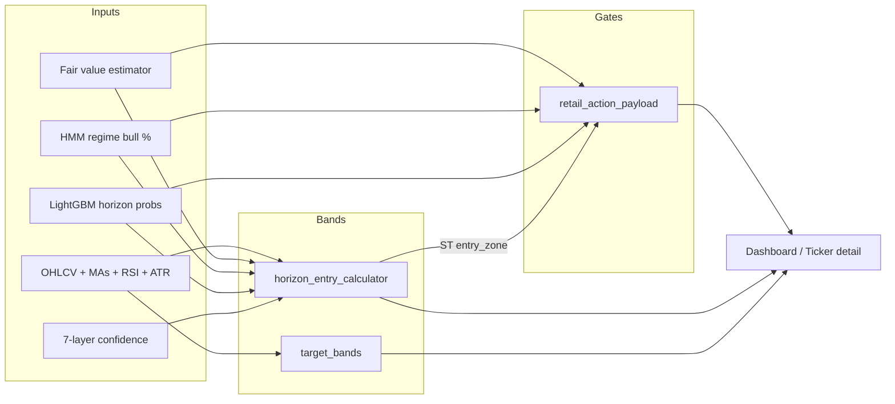

# Price Bands & Trading Gates — Algorithm Reference

> **Internal reference** for Thrive Alpha decision-support logic. Canonical behavior lives in code; update this doc when constants or module contracts change. Not personalized investment advice.

## How to read this doc

- **Bands** = price ranges (entry zones, tiers, stop/target brackets) shown in UI and roadmaps.
- **Gates** = boolean pre-flight checks that can block a tactical “go” even when price sits inside a band.
- Two band pipelines exist: **horizon entry** (ticker detail / investor summary) and **target bands** (daily signals table / scanner rows). They share ideas (ATR, MA, FV) but different modules.



---

## Module map

| Module | Role |
|--------|------|
| `signals/fair_value_estimator.py` | Model fair value (FV) by stock type → MOS math |
| `signals/indicators.py` | Composite buy score 0–100, regime UP/NEUTRAL/DOWN |
| `signals/horizon_entry_calculator.py` | ST / MT / LT entry zones, stops, targets, tier ladder |
| `signals/target_bands.py` | `st_band` / `mt_band` / `lt_band` on signal rows |
| `signals/retail_action_payload.py` | Four primary trading gates + GO/NO-GO |
| `signals/confidence_engine.py` | Fused confidence; feeds horizon verdict nudges |
| `signals/tracking_gate.py` | Freeze gate snapshot on EOD / forward tracking |
| `web/.../retailActionUX.tsx` | UI gate fallback + long-term tier display resolution |

**Config overrides:** `config.yaml` → `score.buy_min` / `sell_max`, `horizons.tier2_mos_pct`, `horizons.tier2_mos_by_class`, per-ticker MOS overrides, `confidence.*`, `overbought_penalty.*`.

---

## 1. Fair value (inputs to MOS & valuation gate)

**File:** `fair_value_estimator.py`

**Pseudo-flow:**

1. **Classify** ticker → `DEEP_VALUE` | `VALUE` | `GROWTH` | `HIGH_GROWTH` | `UNKNOWN` (PE, growth, margins).
2. **Method by class:**
   - Value names → PE-relative vs sector PE (margin / leverage adjustments).
   - Growth → PEG blend (TTM + optional forward PE legs).
   - High growth → forward-PE–led model when data present; else PEG fallback.
3. **Guardrails** → cap vs analyst target, bear case (~60% of FV), methodology note.
4. **Output:** `fair_value`, `discount_pct = (FV − price) / price × 100`.

**Used downstream as:**

- `assessment_pct` (valuation gate): `(FV − price) / price × 100`
- Long-term `min_price_to_buy = FV × (1 − LT_REQUIRED_MOS/100)` (default **25%** MOS for full position)
- Short-term band cap so ST zone does not imply buying above intrinsic

---

## 2. Composite score & daily suggestion (context, not a gate)

**File:** `indicators.py`, `regime.py`

**Default composite (legacy):**

```
composite = 0.5×trend + 0.3×rsi_contrib + 0.2×macd_contrib   → clamp 0–100
```

**Spec composite (`use_spec`):**

```
TS  = zscore( 0.6×(price−MA50)/MA50 + 0.4×(MA50−MA200)/MA200 ) → map to 0–100
MOM = zscore( 0.4×r_3m + 0.4×r_6m + 0.2×(RSI−50)/50 )         → map to 0–100
Score = 0.35×TS + 0.30×MOM + 0.20×VAL + 0.15×QLT   (VAL/QLT when FMP data)
If MA regime ∉ {UP, UP-HV}: Score −= 15
Apply overbought_penalty (RSI >70/80, extension >20%/35% above MA200)
```

**Regime label:** UP if composite ≥ 60, DOWN if ≤ 40, else NEUTRAL.

**Suggestions (`config` thresholds):**

- `score ≥ buy_min` (default **65**) → ADD/BUY wording
- `score ≤ sell_max` (default **35**) → trim/sell wording

---

## 3. Horizon entry bands (investor / ticker detail)

**File:** `horizon_entry_calculator.py` → `build_all_horizons_payload()`

Build order: **short → medium → long** (each step can read prior horizon’s `entry_zone`).

### 3.1 Short-term (~1 month)

**Anchor selection (RSI-driven):**

| RSI | Entry low / high | Quality |
|-----|------------------|---------|
| &lt; 35 | `min(effective_support, VWAP)×0.99` … `×1.01` (or VWAP band if support &gt;10% below spot) | Ideal |
| 35–50 | `VWAP×0.985` … `VWAP×1.005` | Acceptable |
| ≥ 50 | `price×0.99` … `price×1.005` | Stretched |

- **Effective support:** swing support, but ignore levels &gt; **22%** below spot (52w-style floors → long tiers only).
- **FV cap:** narrow band if it would sit above fair value.
- **Display compression:** if `(high−low)/price` &gt; **14%**, cap width to 14% of spot (keeps UI actionable).

**Stop / target:**

```
stop_dist = max(ATR × 1.5, price × 4%)
stop      = entry_low − stop_dist
target    = min(resistance × 0.98, entry_high + ATR × 3.0)
```

**Regime upside cap** (HMM bull % on ticker):

| regime_bull | Max upside % above entry_high |
|-------------|-------------------------------|
| ≥ 48% | none |
| 42–48 | 6.5% |
| 35–42 | 5.0% |
| &lt; 35 | 4.0% |

**Verdict sketch:** BUY if ML≥25, RSI&lt;65, regime≥40, pattern≥55, R/R≥1.5; else WATCH/WAIT. Horizon confidence % can bump verdict one notch.

---

### 3.2 Medium-term (~3 months)

**Anchor: MA50**

| Price vs MA50 | Entry zone | Quality |
|---------------|------------|---------|
| ≤ MA50 | Bridge from `min(price×0.99, MA50×0.97, ST_low)` to `MA50×1.01` | Ideal |
| 0–4% above MA50 | `MA50×0.99` … `MA50×(1+4%)` | Acceptable |
| &gt; 4% above MA50 | `MA50×0.99` … `MA50×1.04` (wait) | Stretched |

**Harmonize with short:** `MT_low ≤ ST_low`; if violated, widen MT band down through ST and up to MA50.

**Stop:**

```
structural_stop = MA50 × (1 − 6%)
If price < MA50 and structural_stop > price×1.02:
    stop = min(entry_low, price) × (1 − 6%)
```

**Target:**

```
quality_mult = 1 + (fund≥70 ? 0.03) + (options≥60 ? 0.02) + (insider≥60 ? 0.02)
target_pct   = (ML_prob/100) × 25 × quality_mult
target       = entry_high × (1 + target_pct/100)
Enforce R/R ≥ 2.0 (bump target), cap vs FV (~+12% max when FV known)
```

**Display compression:** max width **30%** of spot.

---

### 3.3 Long-term (6–18 months) — tier ladder

**Not anchored to spot.** Three tiers + MOS assessment:

| Tier | Formula (defaults) | Intent |
|------|-------------------|--------|
| **T1** | `MA200 × (1 ± 5%)`, ceiling ≤ medium `entry_high` | Starter / MA200 zone |
| **T2** | Center = `FV × (1 − mos_t2%)`, band ± **3%** | Core accumulation |
| **T3** | `52w_low × 1.05` … `× 1.15` | Stress / tail only |

**Tier 2 MOS (`mos_t2`)** — quality class (config + ticker lists):

| Class | Default MOS % |
|-------|----------------|
| high_quality_defensive | 10 |
| large_cap_growth | 15 |
| high_volatility | 25 |
| speculative | 30 |

Resolve: explicit config → per-ticker override → class table → `classify_mos_class(ticker, fundamentals_score)`.

**Full-position MOS ceiling:**

```
mos_pct          = (FV − price) / price × 100
min_price_to_buy = FV × (1 − 25%)    # LT_REQUIRED_MOS_PCT
```

| mos_pct vs thresholds | Assessment |
|-----------------------|------------|
| ≥ 25% | BUY (full MOS) |
| 15–25% | PARTIAL only |
| &lt; 15% | WAIT |

**Active / display tier:**

```
active_tier  = tier containing price (prefer T2 > T1 > T3 if overlap)
target_tier  = nearest tier by distance to band (when outside all bands)
display_zone = active_tier ?? target_tier
```

**Harmonize with short:** widen long `entry_zone.low` to `≤ ST_low` so LT is never a *higher* minimum entry than ST.

**Structural stop:** `structural_invalidation_below(MA200, 52w_low)` (ETFs/metals use max(MA200×0.97, 52w×0.97), not tail-only).

**Target:** fair value (primary); R/R vs T1 for narrative.

**Display compression:** max width **45%** of spot.

---

## 4. Target bands on signal rows (parallel pipeline)

**File:** `target_bands.py` → `add_target_bands(row)`

Used on dashboard signal table / scanner — **not** identical to horizon cards but same vocabulary (ST/MT/LT).

**Short-term band (sketch):**

- Vol-scaled ATR multiples around spot / MA20; swing high/low; prior-day Redis cache with drift check (index ETFs **9%**, others **18%** center drift).
- If spot outside cached band → reset symmetric band around spot: `width ≈ max(ATR×mult, 1.2–1.5% of price)`.
- Event multiplier widens near macro weeks (CPI/FOMC).
- Display cap: width ≤ **18%** of spot.

**Medium / long:** regime + `vol_6m` + analyst consensus / fair PE bands; LT widens with EPS dispersion (`lt_dispersion_multiplier`).

---

## 5. Trading gates (GO / NO-GO)

**File:** `retail_action_payload.py` (backend source of truth; UI mirrors via `buildTradingGateRows` when API payload missing)

### 5.1 Four primary gates

| Gate | Pass when | Default threshold |
|------|-----------|-------------------|
| **valuation** | `assessment_pct ≥ 5` | FV at least ~5% above spot |
| **regime** | `regime_bull_pct ≥ 60` | HMM bull % on **this ticker** |
| **momentum** | `RSI < 50` **and** `pattern_score ≥ 45` | Not chasing extended tape |
| **ml** | `short_ml_prob ≥ 25` | ST LightGBM probability |

Optional 5th gate (investor summary): **confidence** — fused mid ≥ **55%**.

**Weather labels:** bull ≥60, stormy &lt;42, else mixed.

**ML marginal:** pass at ≥25 but `visual_status = marginal` if &lt;55 (absolute).

### 5.2 Aggregate decision

```
primary_gates = {valuation, regime, momentum, ml}
gates_locked  = count(primary where pass == false)
gate_cleared  = (gates_locked == 0)
go_no_go      = "go" | "no_go"
inside_buy_band = price ∈ [ST_entry_low, ST_entry_high]
```

**Important:** Price inside ST band **does not** imply `gate_cleared`. UI copy: band = *where* to buy if gates clear; gates = *whether* to act today.

**Readiness** (`readiness_score.py`): informational only — does not change gate math.

### 5.3 Horizon verdicts vs gates

Horizon cards (ST/MT/LT) compute their own **BUY / WATCH / WAIT** from ML, R/R, RSI, regime, band quality. `overall_verdict` on investor summary can be WATCH while gates are red (e.g. inside band, RSI hot).

---

## 6. Confidence engine (feeds horizons, optional gate)

**File:** `confidence_engine.py`

**Pseudo:**

```
For each layer L ∈ {regime_hmm, pattern_technical, lgbm, options, insider, fundamental, nlp}:
    score_L ∈ [0,1]
Weights = asset-class profile from pre_flight classifier (ETF vs equity vs ADR …)
confidence = weighted_mean(scores present), renormalized if layers missing
Apply hard multipliers (e.g. HMM bear > 80%, heavy insider sell)
Per-horizon profiles: short / medium / long emphasize different weights
```

Horizon calculators use `horizon_confidence_pct` to nudge verdict/conviction (e.g. WATCH→BUY when fused ≥72 on ST).

---

## 7. UI display rules (must match backend intent)

**File:** `web/.../retailActionUX.tsx`

- **`resolveLongHorizonEntryZone`:** `active_tier_id` from API, else tier containing price, else **`pickCurrentTargetTierId`** = **nearest** tier by distance to band (not lowest tier).
- **`LongTermAccumulationScale`:** one price scale — highlight target tier, faint other tiers, **cyan tick** at `min_price_to_buy` (full MOS ceiling).
- **`EntryZonePriceBar`:** scale min/max includes spot, stop, target; edge labels show full scale (not only band high).
- **Owner mode Today:** uses long-term accumulation scale, not ST band alone.

---

## 8. Cross-horizon invariants (design rules)

1. **Never chase upward:** MT entry low ≤ ST entry low; LT display low ≤ ST entry low when harmonized.
2. **Tier 1 ceiling ≤ MT entry high** — investor core entry not above swing top.
3. **Deep support ≠ ST zone** — supports &gt;22% below spot belong in LT tiers / T3, not 1m VWAP chase.
4. **Compress wide bands** for display so “always in zone” does not erode trust.
5. **Regime dampening** on ST targets when HMM bull is weak — avoids 6–10% tactical targets in risk-off tape.
6. **Two MOS concepts:**
   - **Full position ceiling** = `FV × (1 − 25%)` (~$347 when FV ~$463).
   - **Tier 2 band** = partial accumulation at class MOS (e.g. 15% → ~$382–405) — stricter than “inside ST band.”

---

## 9. Forward tracking & backtests

| Module | Use |
|--------|-----|
| `tracking_gate.py` | Persist `gate_cleared`, `go_no_go` on EOD rows |
| `forward_tracking.py` | Optional `require_gates_cleared` filter |
| `gate_backtest.py` | Historical gate pass vs forward returns |
| `scripts/backtest_targets.py` | ST/MT band hit rates |

---

## 10. Tuning checklist

When changing behavior, touch in this order:

1. Constants in `horizon_entry_calculator.py` (ST_/MT_/LT_*)
2. Gate thresholds in `retail_action_payload.py` (ST_ML_GATE, REGIME_GATE, …)
3. `config.yaml` horizons / score / confidence
4. This document + module docstrings
5. `backend/tests/test_horizon_tier_sync.py` and gate/forward-tracking tests

---

## Overview alerts (Today's 3 moves)

**Module:** `signals/alert_provenance.py`

| Field | Meaning |
|-------|---------|
| `story_change_source` | `composite` (regime/score) or `horizon` (ST/MT/LT suggestion flip) |
| `story_change_trigger` | `regime_flip`, `score_drop`, or `suggestion_flip` |
| `story_change_horizon_flips` | e.g. `["short"]` when playbook bucket changed |
| `trim_source` | `composite`, `plan`, or `composite+plan` |
| `trim_triggers` | `score_below_threshold`, `plan_action`, `suggestion_trim` |

---

## Related docs

- `CLAUDE.md` — product architecture summary  
- `docs/audit/SIGNAL_AUDIT_FORWARD_TRACKING.md` — audit & forward outcomes  
- `docs/signals/ALERTS_RETAIL_QUICK_DECISION.md` — alert copy patterns  
